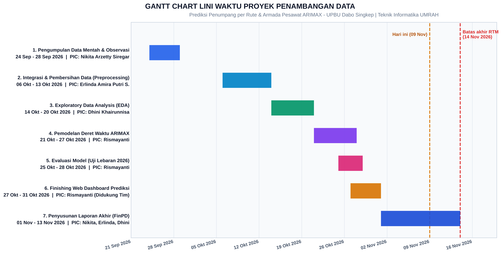
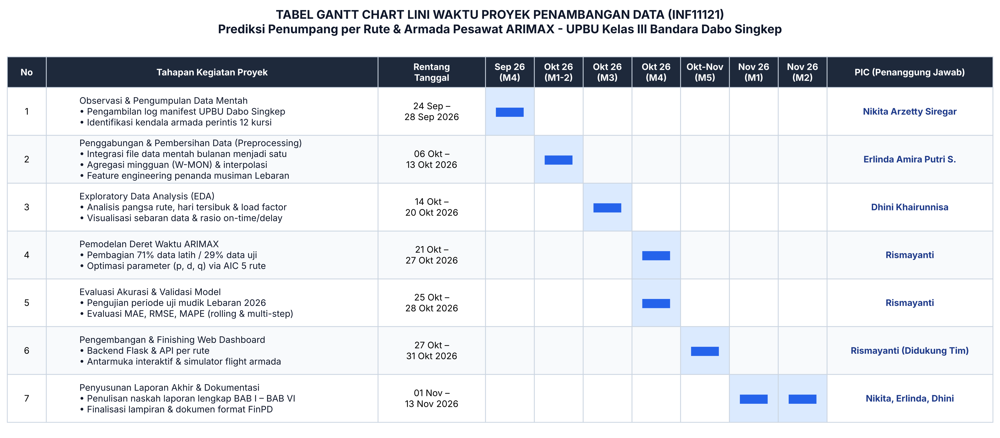

# LINI WAKTU PELAKSANAAN PROYEK (GANTT CHART)
**Mata Kuliah: Penambangan Data (INF11121) - Semester Ganjil 2026/2027**  
**Judul Proyek**: Prediksi Penumpang per Rute dan Kebutuhan Armada Pesawat Menggunakan ARIMAX (Studi Kasus: UPBU Kelas III Bandara Dabo Singkep)

---

### PROFIL TIM KELOMPOK
1. **Nikita Arzetty Siregar** (PIC: Observasi & Pengumpulan Data Mentah)
2. **Erlinda Amira Putri Sudarmono** (PIC: Prapemrosesan & Pembersihan Data)
3. **Dhini Khairunnisa** (PIC: Exploratory Data Analysis & Visualisasi Statistik)
4. **Rismayanti** (PIC: Pemodelan ARIMAX per Rute, Evaluasi Model, & Pengembangan Dashboard Web)
5. **Seluruh Tim / Bersama** (PIC: Integrasi Sistem & Finalisasi Laporan Akhir)

---

### GAMBAR GRAFIK & TABEL GANTT CHART (SIAP INSERT KE WORD / PDF)
Tersedia 2 format visual resolusi tinggi (300 DPI) di folder `laporan/`:
1. **Format Gambar Grafik Batang**: `laporan/gantt_chart_lini_waktu.png`
2. **Format Gambar Tabel Rapi**: `laporan/tabel_gantt_chart.png`

#### 1. Gambar Grafik Gantt Chart

#### 2. Gambar Tabel Gantt Chart

---

### TABEL GANTT CHART (FORMAT TEKS MARKDOWN UNTUK WORD)

Tabel di bawah ini dapat langsung disalin ke **Microsoft Word** pada **BAB I (Sub-bab I.4 Lini Waktu Pelaksanaan)**:

| No | Tahapan Kegiatan Proyek | Rentang Tanggal | Sep '26 (Mgg 4) | Okt '26 (Mgg 1-2) | Okt '26 (Mgg 3) | Okt '26 (Mgg 4) | Okt-Nov (Mgg 5) | Nov '26 (Mgg 1) | Nov '26 (Mgg 2) | PIC (Penanggung Jawab) |
|:--:|:---|:---:|:---:|:---:|:---:|:---:|:---:|:---:| --- |:---|
| **1** | **Observasi Lapangan & Pengumpulan Data** - Pengambilan log operasional penerbangan UPBU Dabo Singkep - Studi literatur kendala kapasitas armada perintis 12 kursi | 24 Sep – 28 Sep 2026 | **████** | | | | | | | **Nikita Arzetty Siregar** |
| **2** | **Integrasi & Pembersihan Data (Preprocessing)** - Menggabungkan data mentah bulanan terpisah menjadi satu - Agregasi mingguan (W-MON) & penanganan interpolasi - Feature engineering penanda musiman Lebaran | 06 Okt – 13 Okt 2026 | | **████** | | | | | | **Erlinda Amira Putri Sudarmono** |
| **3** | **Exploratory Data Analysis (EDA)** - Analisis pangsa rute, hari tersibuk, load factor & delay - Pembuatan grafik sebaran data | 14 Okt – 20 Okt 2026 | | | **████** | | | | | **Dhini Khairunnisa** |
| **4** | **Pemodelan Deret Waktu ARIMAX** - Split data 71% latih / 29% uji (Lebaran 2026) - Grid search parameter (p, d, q) terbaik via AIC per rute | 21 Okt – 27 Okt 2026 | | | | **████** | | | | **Rismayanti** |
| **5** | **Evaluasi Akurasi & Validasi Model** - Pengujian data uji Lebaran 2026 (MAE, RMSE, MAPE) - Pengujian *rolling 1-step* vs *multi-step forecast* | 25 Okt – 28 Okt 2026 | | | | **████** | | | | **Rismayanti** |
| **6** | **Pengembangan Sistem Dashboard Web** - Pembuatan backend Flask & API prediksi interaktif - Desain antarmuka per rute & simulator flight armada | 27 Okt – 31 Okt 2026 | | | | | **████** | | | **Rismayanti** (Didukung Tim) |
| **7** | **Penyusunan Laporan Akhir & Dokumentasi** - Penulisan naskah laporan lengkap BAB I s/d BAB VI - Penyusunan lampiran data dan konversi format FinPD | 01 Nov – 13 Nov 2026 | | | | | | **████** | **████** | **Nikita, Erlinda, Dhini** |

> **Catatan Batas Waktu**:  
> Batas akhir resmi pengumpulan laporan di RTM adalah **14 November 2026**. Penyusunan laporan akhir direncanakan selesai **13 November 2026**, satu hari sebelum batas akhir. Sesuaikan tanggal bila kondisi sebenarnya berbeda.

---

### DETAIL PEMBAGIAN TUGAS (DESKRIPSI RINCI PER ANGGOTA)
Jika dosen meminta uraian deskriptif peran masing-masing anggota di laporan, berikut narasinya:

1. **Nikita Arzetty Siregar**:
   Bertanggung jawab penuh atas tahap *Business Understanding* dan pengumpulan data mentah langsung dari sumber instansi UPBU Kelas III Bandara Dabo Singkep, mencatat karakteristik penerbangan perintis (Cessna 208B 12 kursi), serta memimpin penulisan naskah Laporan Akhir (*FinPD*).

2. **Erlinda Amira Putri Sudarmono**:
   Bertanggung jawab pada tahap *Data Preprocessing*, menggabungkan seluruh file log penerbangan mentah bulanan yang sebelumnya terpisah menjadi satu kesatuan dataset utuh, memilah log penerbangan per rute, menangani baris tanggal yang kosong dengan interpolasi deret waktu teratur, dan turut menyusun naskah Laporan Akhir.

3. **Dhini Khairunnisa**:
   Bertanggung jawab pada tahap *Data Understanding* melalui analisis statistik deskriptif dan EDA (Exploratory Data Analysis), menggali pola hari tersibuk, rute penerbangan paling ramai, rasio ketepatan waktu penerbangan (*on-time vs delay*), serta turut menyusun naskah Laporan Akhir.

4. **Rismayanti**:
   Bertanggung jawab penuh pada bagian teknis komputasi: perancangan algoritma pemodelan **ARIMAX** untuk 5 rute dan agregat, eksperimen parameter orde terbaik via AIC, evaluasi akurasi model terhadap data uji mudik Lebaran 2026 (MAE, RMSE, MAPE), hingga implementasi dan finishing sistem aplikasi Dashboard Web interaktif.

5. **Nikita, Erlinda, dan Dhini**:
   Menyusun dan menyelesaikan penulisan dokumen Laporan Akhir (*FinPD*) dari BAB I sampai BAB VI beserta lampirannya sesuai panduan RTM.
